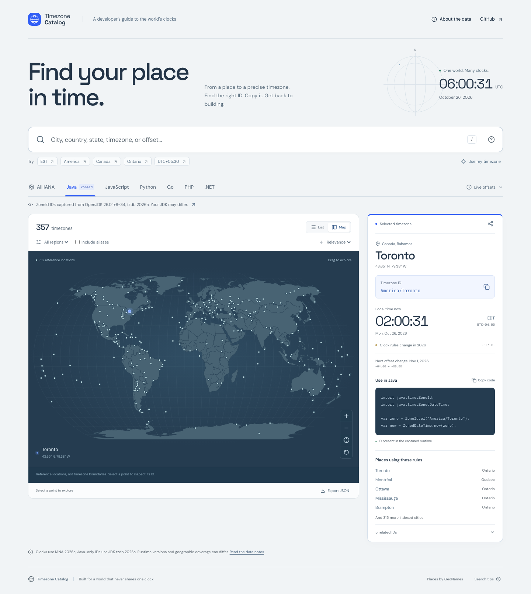

# Timezone Catalog

A geographic timezone workbench for developers. Find a precise timezone ID from
a city, country, state, province, abbreviation, or UTC offset; copy the ID or a
runtime-specific code example; explore the same results on an interactive map.



## Run locally

Requires Node.js 22.12+ (or 24+).

```sh
npm ci
npm run dev
```

Vite prints the local URL. No API keys, account, backend, or external map service
are needed. Fonts, geographic data, and timezone rules are served locally.

```sh
npm test             # Search, timezone rules, completeness, and data invariants
npm run build        # TypeScript checks and production static build
npx playwright install chromium
npm run test:e2e     # Desktop and mobile browser interactions
npm run preview     # Serve the production build
```

## What it does

- All 598 identifiers from pinned IANA tzdb **2026e**, including backward links.
- All **604 `java.time.ZoneId` IDs** from the captured OpenJDK 26.0.1 runtime,
  including 13 Java-only `SystemV/...` IDs with their JDK rules.
- Runtime views for Java, JavaScript, Python, Go, PHP, and .NET.
- A geographic index of **34,188** GeoNames city records and their administrative
  divisions, including states and provinces worldwide.
- Ranked exact, prefix, phrase, and typo matching, with explanations.
- Ambiguous abbreviations remain multi-result searches. `EST` does not silently
  become a single location or a fixed-offset assumption.
- Offset filters use the selected instant. Abbreviations match any usage in the
  selected year, so `EST` can find New York during summer too.
- Copy IDs, copy code, copy a shareable lookup URL, or export filtered JSON.
- Interactive world map with pan, zoom, keyboard-accessible location selection,
  and a control to focus the selected timezone.
- UTC instant selection, live clocks, seasonal summaries, and next offset changes.
- Responsive layout, keyboard navigation, reduced-motion support, clipboard
  fallback, and in-app source/coverage notes.

Aliases are hidden initially for easier browsing. Enable **Include aliases** to
see every ID in the chosen profile. The full Java view then contains 604 IDs.

## Search examples

| Query | Meaning |
| --- | --- |
| `EST` | Zones using the abbreviation in the selected year |
| `America` | IDs, regions, and geographic names containing America |
| `Canada Ontario` | Match both terms |
| `country:CA state:Ontario` | Country code and administrative subdivision |
| `province:Quebec` | `province:` is an alias for `state:` |
| `city:"New York"` | A quoted city name |
| `region:America offset:-05:00` | IANA region and offset at the selected instant |
| `UTC+05:30` | Offset at the selected instant |
| `abbr:IST` | All matching abbreviation meanings |
| `id:US/Eastern` | An ID or related alias |
| `type:alias` | Alias records; enable Include aliases |

Terms are combined with AND. Field names are `id`, `city`, `state`, `province`,
`country`, `region`, `abbr`, `offset`, and `type`. Text matching ignores accents
and case. Typos are suggested only when there are no strong exact matches.

Press `/` to focus search and `Escape` to clear it. Results and map locations are
keyboard accessible. Use the share button in the inspector to copy the current
search, selected zone, runtime, view, filters, and frozen reference instant.

## Runtime guarantees

| View | Availability evidence |
| --- | --- |
| All IANA | Complete pinned tzdb identifier inventory |
| Java | `ZoneId.getAvailableZoneIds()` from OpenJDK 26.0.1+8-34, tzdb 2026a |
| JavaScript | `Intl.DateTimeFormat` acceptance checked in the visitor's browser |
| Python | `zoneinfo.available_timezones()` from Python 3.14.4, system tzdb 2026e-rearguard |
| Go / PHP / .NET | IANA reference and language snippets; installation-specific availability is not claimed |

See `src/data/runtimes.json` for exact snapshot versions, capture time, and ID
inventories. The file is authoritative if this prose drifts after a refresh.
Java short-ID overrides (`ZoneId.SHORT_IDS`) are captured as reference metadata;
they are not additional IDs accepted by `ZoneId.of(String)`.

**Displayed clocks always use the bundled IANA 2026e rules.** Java-only IDs use
the captured JDK's rules. Runtime filters assert identifier availability, not
identical transition data. An older runtime may recognize an ID but calculate
a different offset after a recent legislative change. .NET examples use IANA
IDs; Windows registry timezone names are not included. On Windows, IANA support
requires .NET 6+ with ICU enabled.

## Data, refreshes, and limitations

- [IANA tzdb](https://www.iana.org/time-zones): public-domain timezone identifiers,
  links, coordinates, and metadata. Version pinned in `scripts/build-data.mjs`.
- [Moment Timezone](https://momentjs.com/timezone/): build-time conversion of the
  matching IANA rules. Its tzdb version is checked against the pinned release;
  Moment is not shipped as an application runtime dependency.
- [GeoNames](https://www.geonames.org/): cities15000, country names, and admin1
  divisions, adapted under [CC BY 4.0](https://creativecommons.org/licenses/by/4.0/).
- [Natural Earth](https://www.naturalearthdata.com/): public-domain geographic
  outlines distributed through [world-atlas](https://github.com/topojson/world-atlas).

`public/data/provenance.json` records input URLs and SHA-256 checksums. GeoNames
inputs are cached locally and excluded from Git. Derived data is committed so
ordinary builds do not require Java, Python, or a live data download.

```sh
# Refresh installed Java / Python / Node ID inventories. Requires Java 17+ and Python 3.9+.
npm run runtimes:refresh

# Regenerate from cached input files, downloading missing files.
npm run data:refresh

# Download the current GeoNames inputs again and regenerate.
npm run data:refresh -- --download
```

Set `JAVA_BIN` and `PYTHON_BIN` to capture particular installations. After changing
the pinned IANA release, install a matching Moment Timezone data release, refresh
the runtime snapshots, regenerate data, inspect changes, and run checks.
`factory` is included as an explicitly labeled unspecified-timezone placeholder.

Calculations are bounded to **1970–2100**. Future dates apply the bundled rules,
which governments can change. The geographic index is sampled city data, not a
complete city gazetteer or authoritative subdivision-to-timezone table. A state
or province can span multiple timezones; a city-free portion can be absent.
The map shows IANA **reference locations, not timezone boundaries**. Countries
listed together share a ruleset in the default IANA build; an ID does not imply
that all of a country observes that timezone.

## Deploy

The site is deployed to **https://timezonetool.ericlmao.com/** using GitHub Pages.
The repository's Pages publishing source is **GitHub Actions**.

The included workflow tests and builds every push to `main` and every pull
request. After all checks pass, pushes to `main` deploy `dist/` to the
`github-pages` environment. Pull requests run checks without deploying. The
workflow can also be started manually from the Actions tab.

`public/CNAME` is copied to `dist/CNAME` by Vite. The custom domain is also
configured in the repository's Pages settings; Actions deployments do not
configure a domain from the CNAME file alone.

The DNS provider must have this record:

| Type | Name | Target |
| --- | --- | --- |
| CNAME | `timezonetool` | `ericlmao.github.io` |

Enable **Enforce HTTPS** in Pages settings once GitHub issues the custom-domain
certificate. DNS must resolve correctly before certificate issuance can finish.

`npm run build` produces a static `dist/` directory that can also be served by
other static hosts. Relative asset paths support custom-domain roots and GitHub
Pages subdirectories. No SPA rewrite is required: shareable state uses query
parameters on the root page.

## Design and stack

React, TypeScript, Vite, a small custom search engine, and D3 geographic projection.
The map is loaded on demand. Fonts are self-hosted. The cartographic workbench
direction follows the requested
[Anthropic frontend-design skill](https://github.com/anthropics/claude-code/blob/main/plugins/frontend-design/skills/frontend-design/SKILL.md).
See [docs/DESIGN.md](docs/DESIGN.md) for the design tokens and rationale, and
[THIRD_PARTY_NOTICES.md](THIRD_PARTY_NOTICES.md) for attribution.
